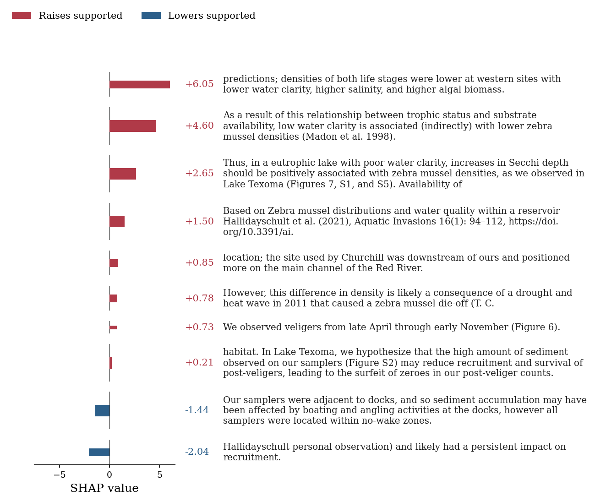
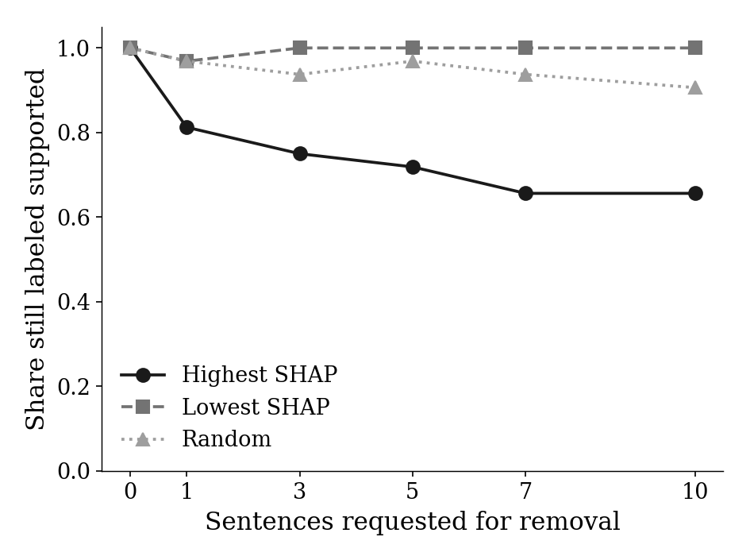
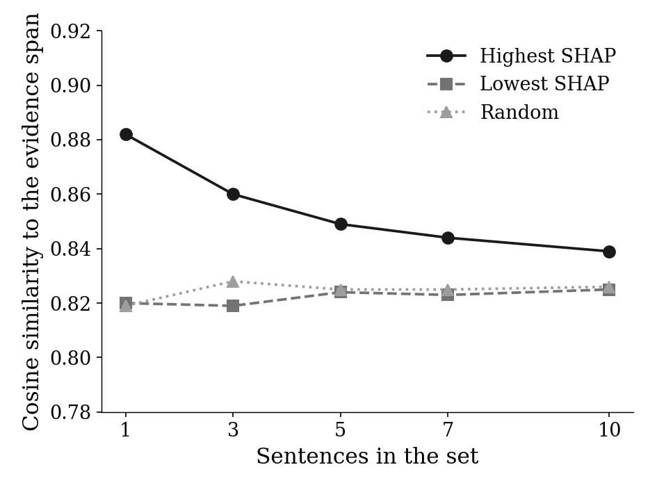
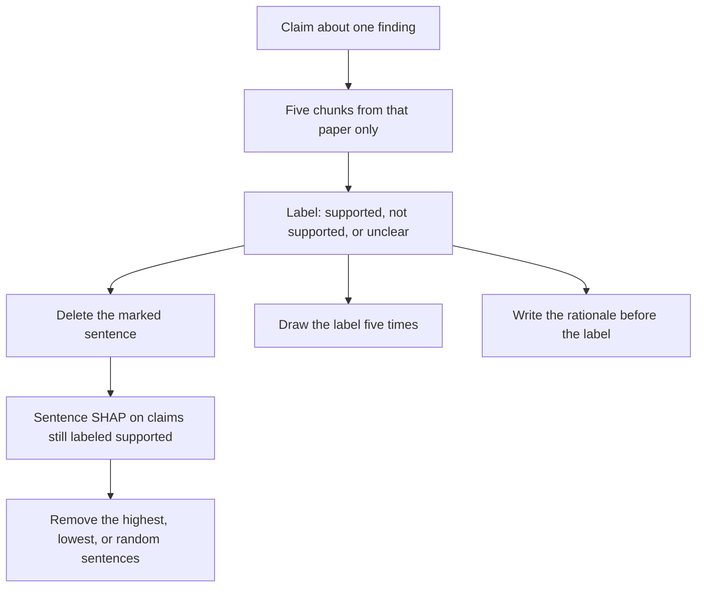

<div align="center">

# The Evidence Span Rarely Carries the Verdict

**SABLE** · Span Ablation for Black-box Label Evaluation

A feasibility study on invasion-biology claims

Luca Rippe

</div>

A same-paper retriever and `gpt-4o-mini` often match the human label. Deleting the sentence an annotator marked as evidence usually leaves that label where it was. A few other sentences move it.

| **48** | **67** | **40 / 67** | **53 / 67** | **2 / 40** |
|---|---|---|---|---|
| CC BY papers, 31 journals | claims | marked sentences in the top five chunks | labels match the human label | labels change when the marked sentence is deleted |

The marked sentence is often retrieved, and the label often matches. For the 40 claims where the model actually saw that sentence, deleting it changes the label twice. On the claims that stay *supported*, the sentences with the highest SHAP values are the ones that move the label. Sentences with low values, and sentences chosen at random, do not.

## The sentence, and the sentence that replaces it

One claim, from Hallidayschult et al. (2021), *Aquatic Invasions*, [10.3391/ai.2021.16.1.07](https://doi.org/10.3391/ai.2021.16.1.07), CC BY 4.0. In the tables it is `c001`.

**Claim.** In Lake Texoma, densities of zebra mussel veligers and post-veligers were lower at western sites with lower water clarity, higher salinity, and higher productivity.

**Sentence the annotator marked.** We found that densities of both life stages were lower at western sites with lower water clarity, higher salinity, and higher productivity.

The retriever returns a chunk that contains this sentence. The model labels the claim *supported*. After the sentence is deleted, the label is still *supported*. The new rationale cites a near-copy: densities were lower at western sites with lower water clarity, higher salinity, and higher **algal biomass**.

That near-copy is the highest sentence SHAP value on this claim, +6.05. Seventeen of the 27 sentences in the retrieved chunks are zero and are left off the figure. The text is the PDF extract, so a header fragment is glued to the front of the top sentence.



Red raises the log probability of the token *supported*. Blue lowers it. The top sentence is the finding again, with one word changed. A high value can also land on a broken piece of the extract. On another claim, `c005`, the highest sentence is a fragment about a detection limit, and a sentence that states where the species was found sits at the bottom of the ranking.

## High-valued sentences move the label

The deletion above is the common case: 38 of the 40 retrieved spans can be removed and the temperature-0 label stays. The two that move are `c010`, from *not supported* to *supported*, and `c062`, from *supported* to *not supported*. Both had matched the human label before the deletion.

The two figures stay with the 32 claims that are still *supported* after the span is gone. One of them, `c035`, has the human label *unclear*, so a *supported* prediction matches the human label on 31 of the 32. On the left, each point is the share whose majority label, over five samples, is still *supported*. On the right, the same sentences are compared with the marked sentence. That axis starts at 0.78 so the small gap is visible.

<table>
<tr>
<td width="50%" valign="top">

</td>
<td width="50%" valign="top">

</td>
</tr>
</table>

Removing the single highest sentence leaves 26 of the 32 labels *supported*. Removing the ten highest leaves 21. At that last step the highest set contains 9.44 sentences on average, because only sentences with a positive value are removed. Removing the same number of lowest-valued sentences leaves 31, then 32. Removing random sentences leaves 29 to 32. The label sits in a few sentences, and removing the same count of other sentences leaves it in place.

## Only slightly closer to the marked sentence

Taken together, the high-valued sentences sit only slightly nearer the marked sentence than the other sentences from the same chunks. Every retrieved sentence is already close to the span: cosine similarity averages 0.826, and the least similar sentence in the pool is still at 0.689.

The single highest sentence averages 0.882, against 0.819 for one random sentence and 0.820 for the lowest sentence. It is closer than the random sentence in 27 of 32 claims. Once the set holds ten sentences, the mean gap is 0.014. Inside a claim, the rank correlation between the SHAP value and this similarity averages 0.193.

A cosine near 0.82 is what sentences from the same paper look like in this embedding. The `c001` paraphrase and the `c005` fragment are the two readings of a high value.

## Stable, including when the label is wrong

Five draws, temperature 0.7, were taken for 587 prompts. The draws agree with each other on 549 of them. Mean confidence on those prompts is 0.983, and 0.597 on the other 38. Confidence here is the probability of the first label token, averaged over the draws that produced the majority label.

On the 67 original prompts the majority matches the temperature-0 label 66 times, and the human label 52 times, one fewer than the single decode. Mean confidence is 0.981 when that majority matches the human label and 0.923 when it does not. Only 3 of the 67 prompts disagree within the five draws. The samples repeat the label, including a wrong one. They do not mark the misses.

Asking for the rationale before the label, at temperature 0, changes 6 of the 67 labels. Five of the six new labels are *unclear*. Two claims become correct, two become incorrect, and two change while staying incorrect. The number of matches to the human label stays 53.

## Where the headline numbers come from

The marked sentence is in the top five chunks for 40 of 67 claims. *Not supported* is the label the retriever misses: the claim states a finding, and the span denies it, so a chunk that mentions the finding can outrank the denial.

| Human label | In the top five | Missed | Claims |
|---|---:|---:|---:|
| Supported | 32 | 14 | 46 |
| Not supported | 3 | 10 | 13 |
| Unclear | 5 | 3 | 8 |
| All | 40 | 27 | 67 |

At temperature 0 the predicted label matches the human label on 53 of 67 claims. Rows below are the human label.

| Human label | Not supported | Supported | Unclear |
|---|---:|---:|---:|
| Not supported | 10 | 3 | 0 |
| Supported | 4 | 42 | 0 |
| Unclear | 6 | 1 | 1 |

## How a label was produced

Each claim is one finding in one paper: spread, establishment, impact, detection, or management. The rules were fixed before any model was run. One annotator applied them. A second claim from the same paper is allowed only when it is a different finding. The themes are 12 freshwater papers, 12 plant, 8 marine, 8 insect, and 8 other, with at most two papers from any journal.



The full text is split into chunks of 1,000 characters with an overlap of 200, embedded with `text-embedding-ada-002`, and searched inside that paper's DOI. The query is the claim. The gold label and the marked sentence are not shown to the labeler. The labeler is `gpt-4o-mini`. It returns JSON, with the label before the rationale, and it is told to use only the supplied passages.

Sentence SHAP is restricted to the 32 claims that stay *supported* after the span is removed. The value is the log probability that the label starts with the token *supported*. A sparsity penalty keeps at most ten sentences away from zero. The same sentences are then deleted in sets of 1, 3, 5, 7, and 10: highest values, lowest values, and a random order fixed per claim.

## Scope

Sixty-seven claims, one annotator, one evidence span per claim, one model. The spans keep the defects of the PDF extract, and those defects enter the deletion and the SHAP sentences. The search never leaves the source paper. SHAP explains one score under a penalty that sets most sentences to zero. Confidence is the probability of the first label token, not of the whole label. The five draws are one sample at one temperature.

Deleting a sentence edits the prompt. It is not an estimate of a biological effect. The study says where this label comes from in the prompt. It does not say that the model has checked the paper.

## Materials

The full texts come from the Zenodo record [10.5281/zenodo.14525619](https://doi.org/10.5281/zenodo.14525619) (Jennifer D'Souza, TIB, CC BY 4.0). This repository does not contain that corpus. `data/SOURCES.csv` lists the 48 papers kept after a CC BY check of each publisher page or PDF. One of them is CC BY 3.0 (`10.1002/ecs2.2097`).

`data/CLAIMS.csv` holds the 67 claims, the labels, and the evidence spans. The condition tables are the CSV files in `results/`. The three figures above are drawn from those tables.

<details>
<summary>Files and how to regenerate the tables</summary>

| Path | What it holds |
|---|---|
| `data/CLAIMS.csv` | 67 claims, labels, and evidence spans |
| `data/SOURCES.csv` | 48 papers, with DOI, journal, theme, and the checked license |
| `results/predictions.csv` | Temperature-0 label for each claim |
| `results/intervention.csv` | Label after the evidence span is deleted |
| `results/shap_sentences.csv` | Sentence-level SHAP values for the 32 claims that stay *supported* |
| `results/shap_removal.csv` | Sentences removed in each ablation |
| `results/results.csv` | Temperature-0 labels after those removals |
| `results/sampled_labels.csv` | Every draw from the five-sample runs |
| `results/sampled_summary.csv` | Majority label, agreement, and confidence |
| `results/results_sampled.csv` | Sampled labels by condition |
| `results/similarity_results.csv` | Mean cosine similarity to the evidence span |
| `results/similarity_by_claim.csv` | The same similarity, one row per claim |
| `results/shap_similarity.csv` | Sentence-level similarity |
| `results/order_predictions.csv` | Labels when the rationale is written first |
| `figures/` | The three figures in this poster |
| `main.ipynb` | The run, from retrieval through the order check |
| `scripts/` | The same steps as importable runners |

`results/intervention_2.csv` is the temperature-0 run that removes the three highest-SHAP sentences. The later tables reuse that condition.

The tables are already in the repository. Regenerating them calls the OpenAI API. To rebuild the index, place `publications_tdm.csv` at `data/zenodo/publications_tdm.csv`.

```bash
python -m venv .venv
source .venv/bin/activate
pip install -r requirements.txt
```

Put `OPENAI_API_KEY` in a `.env` file in this directory. The notebook and the scripts load that file by path. Numpy must stay below 2.

```bash
python -m scripts.sentence_shap
python -m scripts.sample_labels
python -m scripts.shap_similarity
python -m scripts.order_intervention
```

`sentence_shap` also rebuilds the Chroma index under `chroma_db/`.

</details>
